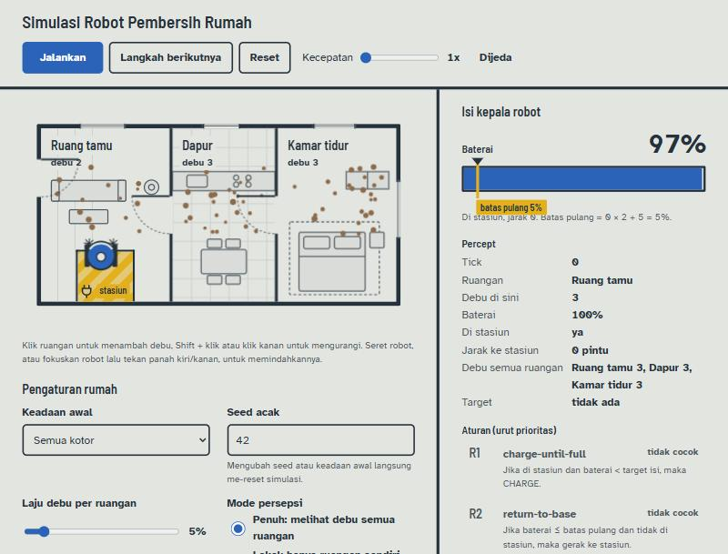
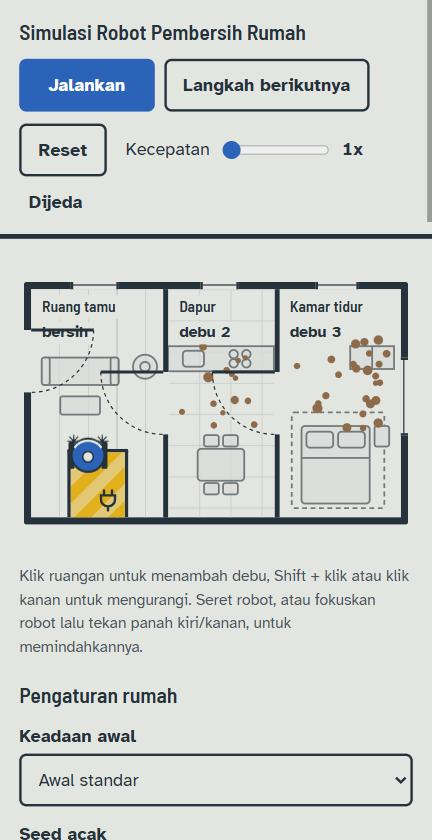

# Simulasi Robot Pembersih Rumah (Pintar Daya)

Satu robot pembersih merawat tiga ruangan rumah (ruang tamu, dapur, kamar tidur) yang terus berdebu. Robot memutuskan sendiri kapan membersihkan, berpindah, dan pulang mengisi daya, tanpa kehabisan baterai di tengah lantai. Agen berbasis aturan condition-action; setiap keputusan menampilkan percept, aturan yang menyala, aksi, dan alasannya.



## Cara menjalankan

```
cd robot-gudang
python -m http.server 8000
```

Buka `http://localhost:8000`. Tanpa build step dan tanpa dependensi.

Tes logika agen (Node 18 ke atas):

```
cd robot-gudang
node --test
```

Eksperimen untuk laporan (100 seed × 1.000 tick × 3 laju debu × 2 mode persepsi, sekitar 2 detik):

```
cd robot-gudang
node eksperimen.js
```

## Struktur

| File | Isi |
|---|---|
| `js/config.js` | semua angka (biaya baterai, ambang, laju debu) dan preset keadaan awal |
| `js/world.js` | lingkungan: ruangan, debu, stasiun, efek aksi, PRNG ber-seed |
| `js/agent.js` | percept, aturan R1 sampai R5 (+R4b), pemilihan aksi. Tanpa DOM |
| `js/simulation.js` | loop tick, jalan/jeda/langkah/kecepatan, riwayat, metrik. Tanpa DOM |
| `js/chart.js` | grafik baterai SVG buatan sendiri |
| `js/ui.js` | satu-satunya modul yang menyentuh DOM |
| `tests/agent.test.js` | tes `node --test` |

## PEAS

| Komponen | Isi |
|---|---|
| Performance | tingkat debu dibersihkan, rata-rata debu per ruangan, energi terpakai, jumlah kejadian baterai kritis, nol kejadian mati di tengah lantai |
| Environment | rumah dengan tiga ruangan berjajar dihubungkan pintu: Ruang tamu (1, dok pengisian), Dapur (2), Kamar tidur (3); debu bertambah acak (ber-seed) tiap tick |
| Actuators | `CLEAN`, `MOVE_LEFT`, `MOVE_RIGHT`, `CHARGE`, `WAIT` |
| Sensors | posisi ruangan, debu di ruangan saat ini, level baterai, apakah di stasiun, jarak ke stasiun; mode Penuh juga melihat debu semua ruangan |

Sifat lingkungan: mode Penuh *fully observable*, mode Lokal *partially observable*; stokastik (debu muncul acak); sekuensial; dinamis; diskret; agen tunggal.

## Initial state, percept, aksi

Initial state standar:

```js
{ tick: 0, robot: { room: 1, battery: 100 }, rooms: { 1: { dust: 0 }, 2: { dust: 2 }, 3: { dust: 3 } }, seed: 42 }
```

Percept per tick:

```js
{ tick, room, dustHere, battery, atStation, distanceToStation, dustAll /* hanya mode Penuh */ }
```

| Aksi | Efek | Biaya baterai |
|---|---|---|
| `CLEAN` | debu ruangan saat ini turun 1 | 3 |
| `MOVE_LEFT` / `MOVE_RIGHT` | pindah satu ruangan | 2 |
| `CHARGE` | hanya di stasiun | +10 per tick, maksimal 100 |
| `WAIT` | tidak melakukan apa-apa | 0,5 |

## Aturan (urut prioritas, aturan pertama yang cocok menang)

`batasPulang = jarakKeStasiun × moveCost + safetyMargin` = `jarak × 2 + 5`. Ruang tamu: 5%, Dapur: 7%, Kamar tidur: 9%.

| # | Nama | Kondisi | Aksi |
|---|---|---|---|
| R1 | `charge-until-full` | di stasiun dan baterai < 95 | `CHARGE` |
| R2 | `return-to-base` | tidak di stasiun dan baterai ≤ batas pulang | gerak satu langkah ke stasiun |
| R3 | `clean-here` | debu di sini > 0 dan baterai − 3 ≥ batas pulang | `CLEAN` |
| R4 | `go-to-dirtiest` | ada ruangan berdebu yang terjangkau | gerak satu langkah ke target |
| R4b | `patrol-stale` | mode Lokal saja: ada ruangan yang tidak dilihat selama ≥ 15 tick | gerak ke ruangan paling lama tidak dilihat |
| R5 | `idle-at-base` | tidak ada pekerjaan yang terjangkau | ke stasiun jika belum di sana, selain itu `WAIT` |

Detail R4:

- Target = ruangan dengan debu tertinggi. Seri: yang terdekat. Seri lagi: nomor ruangan terkecil.
- Komitmen: target dipilih sekali dan ditahan sampai tercapai, sampai debunya hilang, atau sampai R2 menyela.
- Terjangkau artinya `baterai − jarak × 2 − 3 ≥ batasPulang(target)`: robot bisa sampai, membersihkan sekali, dan masih bisa pulang.

`decide(percept, memory)` mengembalikan `{ action, ruleId, reason, target, threshold }`. `reason` adalah kalimat yang tampil apa adanya di UI.

### Kenapa robot tidak pernah mati

Setiap aksi yang diambil saat baterai di atas batas pulang menjaga baterai setelahnya tetap ≥ batas pulang di ruangan berikutnya (R3 dan R4 memeriksa ini sebelum menyala). Begitu baterai menyentuh batas, R2 mengambil alih. Setiap langkah pulang mengurangi baterai dan batas pulang dengan jumlah yang sama (2), jadi robot tiba di stasiun dengan sisa minimal `safetyMargin` (5%). Tes menjalankan 10.000 tick × 20 seed × 4 preset × 2 mode persepsi dengan laju debu 2% sampai 40% dan tidak ada satu pun kejadian mati.

## Metrik

Tingkat debu dibersihkan, total tick, sesi isi daya, energi terpakai, rata-rata debu per ruangan, kejadian baterai kritis (berapa kali R2 mulai menyala). Tombol **Ekspor CSV** menyimpan metrik, seed, preset, mode, dan seluruh log keputusan (sampai 5.000 tick terakhir) dalam satu file.

## Cara memakai UI

- **Jalankan / Jeda / Langkah berikutnya / Reset**, slider kecepatan 1x sampai 20x.
- Klik ruangan: tambah debu. `Shift` + klik, `Shift` + `Enter`, atau klik kanan: kurangi debu.
- Seret robot ke ruangan lain, atau fokuskan robot lalu tekan panah kiri/kanan.
- Pintasan: `Spasi` jalan/jeda, `→` langkah berikutnya, `R` reset. Pintasan tidak aktif saat mengetik di kolom isian.
- Preset: Awal standar, Semua kotor, Baterai tipis di kamar tidur, Rumah bersih, Paksa gagal (demo).
- Mengubah seed atau preset langsung me-reset simulasi. Seed yang sama selalu menghasilkan urutan debu yang sama.



## Keputusan desain

Hal yang tidak diatur spesifikasi, dipilih yang paling sederhana:

1. **R3 dan R4 memeriksa cukup baterai.** R4 hanya menargetkan ruangan yang terjangkau. Tanpa ini robot bisa berjalan ke ruangan jauh lalu langsung dipaksa pulang oleh R2 tanpa membersihkan apa pun.
2. **R5 juga menangani "debu di luar jangkauan".** Jika masih ada debu tetapi tidak ada yang terjangkau, robot pulang ke stasiun (lalu R1 mengisi daya). Alasannya menyebut hal ini.
3. **R2 memakai `≤`, R3 memakai `≥` setelah biaya CLEAN.** Robot boleh membersihkan sampai baterai tepat di batas pulang, lalu R2 langsung menyala. Ini memaksimalkan kerja tanpa melanggar batas.
4. **Robot mati** jika biaya aksi lebih besar dari sisa baterai, atau baterai mencapai 0, di luar stasiun. Hanya preset "Paksa gagal (demo)" yang dibuat untuk memicunya (baterai 3% di kamar tidur, butuh 4% untuk pulang).
5. **Urutan tick:** percept, keputusan, efek aksi, lalu debu baru muncul. Debu baru baru terlihat agen di tick berikutnya.
6. **Pindah robot dengan seret menghapus komitmen target**, karena situasinya berubah mendadak.
7. **Mode Lokal** (Fase 4): agen menyimpan memori debu terakhir dan tick terakhir tiap ruangan dilihat. Ruangan yang belum pernah dilihat atau tidak dilihat selama 15 tick dipatroli oleh R4b. Mengganti mode mengosongkan memori.
8. **Satu tombol Ekspor CSV** untuk metrik dan log sekaligus, supaya satu aksi punya satu nama.
9. **Hanya tema terang.** Denah memakai gaya kertas gambar arsitek dengan palet spesifikasi; tidak ada palet gelap yang didefinisikan, jadi tidak ada toggle tema.
10. **Tema rumah, bukan gudang.** Atas permintaan, denah diganti menjadi rumah: dinding luar 6 px, dinding dalam 4 px dengan celah pintu dan busur ayun daun pintu, simbol jendela, lantai berbeda per ruangan (papan kayu, ubin, karpet), dan perabot tampak atas (sofa, meja, tanaman, meja dapur, kompor, meja makan, lemari, kasur). Nama ruangan diatur di `config.js` (`roomNames`) dan dipakai juga di alasan agen. Logika agen tidak berubah; ruangan tetap berjajar 1-2-3 supaya jarak ke stasiun tetap jumlah pintu.
11. **Teks status kritis memakai tinta baja**, bukan merah, karena merah kritis di atas beton hanya 4,47:1 (di bawah AA untuk teks kecil). Merah dipakai untuk bingkai, ikon, dan angka baterai berukuran besar (≥3:1 untuk teks besar).
12. **Render memakai `setTimeout`, bukan `requestAnimationFrame`,** supaya UI tetap terbarui di tab atau panel yang tersembunyi.
13. **Micro animation hanya sebagai reaksi.** Debu muncul memantul dan mengecil saat dibersihkan; cincin biru singkat saat ruangan diklik; sikat samping robot berputar hanya saat `CLEAN`; robot berputar menghadap arah gerak; lensa berdenyut kuning saat mengisi; angka baterai membesar sedikit saat bertambah; kotak status kritis bergoyang sekali saat muncul; baris log terbaru berkedip tipis; robot bergoyang sekali saat mati. Semua animasi dan transisi dimatikan saat `prefers-reduced-motion: reduce`.
14. **Robot berjalan seperti robot vakum, tidak melompat.** Gerak memakai Web Animations API di `ui.js`: robot berputar di tempat menghadap titik berikutnya, lalu maju dengan percepatan dan perlambatan per segmen. Pindah ruangan selalu lewat celah pintu (titik antre sebelum dan sesudah pintu). Saat `CLEAN` robot menyapu melengkung ke titik acak di ruangan; saat `CHARGE`/`WAIT` ia kembali ke dok dan menghadap atas. Durasi gerak = 92% dari satu tick, jadi selesai sebelum keputusan berikutnya. Titik sapuan memakai `Math.random` karena hanya tampilan dan tidak memengaruhi seed simulasi. Satu tick pada kecepatan 1x dinaikkan dari 600 ms ke 1000 ms (`baseTickMs`) supaya perjalanan antar ruangan terlihat jelas. Saat `prefers-reduced-motion: reduce`, robot langsung berada di titik tujuan.
